# Hermes CFE

An auditable, safety-first pipeline for CFE invoice intake and CFDI harvesting.

> **Status: prototype / supervised pilot. Not production-ready.** The repository
> documents the target architecture and safety policy; the end-to-end WhatsApp
> trigger, durable queue and supervised worker have not been deployed or verified.

## What this project is for

- Receive CFE invoice PDFs through an authorized WhatsApp uploader.
- Preserve the source document and extract/validate its 12-digit RPU.
- Retrieve the canonical CFE CFDI XML using an authorized Contigo or MiEspacio
  workflow.
- Validate the CFDI and ingest it through the canonical Supabase RPC.
- Track each job, retry transient failures safely and route account/access issues
  to an operator instead of inventing credentials or silently dropping work.

This is a **design-and-test repository**, not a place for real customer documents,
credentials or production data.

## Architecture

```mermaid
flowchart LR
  subgraph Intake["1 · Intake boundary"]
    WA[Authorized WhatsApp uploader] --> PDF[PDF message attachment]
    PDF --> ST[(Private Supabase Storage)]
    ST --> EVT[Storage event / outbox]
  end
  subgraph Control["2 · Durable control plane"]
    EVT --> IDEM[Idempotency by bucket + key + version]
    IDEM --> QUEUE[(Harvest job queue)]
    QUEUE --> CLAIM[Atomic claim + expiring lease]
    CLAIM --> WORKER[Supervised worker]
    WORKER --> STATE[Job state + redacted audit summary]
    STATE --> QUEUE
  end
  subgraph Validation["3 · Document validation"]
    WORKER --> FETCH[Fetch exact object version]
    FETCH --> PDFCHECK[PDF type / size / integrity]
    PDFCHECK --> RPU[Strict RPU extraction]
    RPU --> BILL[Invoice fields + cross-checks]
  end
  subgraph Providers["4 · Authorized CFE retrieval"]
    BILL --> CREDS[Credential lookup]
    CREDS -->|credential confirmed| CONTIGO[Contigo via Android + ADB]
    CREDS -->|credential unavailable| EXCEPTION[Recoverable operator exception]
    CONTIGO --> MAIL[Fresh CFE XML email]
    BILL -. historical/backfill only .-> MIESPACIO[MiEspacio via MX Browser Use]
  end
  subgraph Canonical["5 · Canonical CFDI data path"]
    MAIL --> XML[Parse and validate CFDI]
    MIESPACIO --> XML
    XML -->|mismatch / invalid| EXCEPTION
    XML -->|valid| RPC[Canonical Supabase ingest RPC]
    RPC --> RAW[(raw_cfe canonical XML)]
    RAW --> TYPED[(Versioned parser → cfe typed model)]
    TYPED --> CRM[(crm projections, if applicable)]
  end
  subgraph Operations["6 · Operations and user experience"]
    STATE --> PORTAL[Receipt portfolio + harvest monitor]
    EXCEPTION --> INBOX[Exception worklist + explicit requeue]
    RAW --> PORTAL
    TYPED --> PORTAL
  end
```

The production path is deliberately **queue + outbound-polling worker**, not a
public webhook into an assistant session. Model-generated summaries may help
operators; only verified code/data results decide job state.

## Mermaid system maps

- `docs/architecture.mmd` — current-state evidence and proposed end state.
- `docs/data-lifecycle.mmd` — PDF → XML → raw → typed/projection data lifecycle.
- `docs/operations.mmd` — job states, retries, leases and human exception path.

The proposed subgraphs are architecture intent, not proof of deployed services.

## Data contract

The expected lifecycle is:

1. **Storage object:** private PDF and immutable object identity/version.
2. **Queue record:** bucket/key/version, state, attempts, lease, retry schedule,
   redacted error class and compact summary. A unique key prevents duplicate
   delivery of the same object version.
3. **Validated intake:** strict RPU, invoice-derived fields and source key. A PDF
   field is not a CFDI fact; values remain provisional until confirmed by XML.
4. **CFDI XML:** parse the CFDI 4 root/namespace, UUID, RPU/service identifier,
   billing period and necessary invoice attributes. Reject missing, malformed or
   cross-RPU XML; do not fill missing RPU/period with guesses/current date.
5. **Canonical ingest:** call the existing, schema-verified Supabase ingest RPC.
   Interpret its specific inserted/duplicate result and read back the canonical
   row before marking harvest complete.
6. **Typed and customer views:** populate typed `cfe.*` entities and any `crm.*`
   projection only through the verified existing data pipeline.

Do not infer live columns or table joins from a proposed model. See
`docs/data-model.md` and `docs/sql-contract.md` for discovery/query templates.

## Job states

Expected state vocabulary (must be reconciled with the live DB enum/constraints):

- `queued` — accepted and deduplicated.
- `running` — worker owns a time-bounded lease.
- `retry_wait` — transient provider/phone/database failure with backoff.
- `harvested` — valid CFDI ingested or recognized canonical duplicate verified.
- `business_exception` — operator action required, such as a verified CFE account
  whose credential cannot be recovered.
- `failed` — permanent invalid input or exhausted automatic retries; preserve
  reason and source.

A missing credential is not permission to re-register. Any credential RPC error
other than an explicit, schema-verified “not found” result is an unavailable
lookup, never “account absent”.

## Queries and SQL contract

Start with the read-only discovery queries in `docs/sql-contract.md`. That doc
contains example queries for job history, exceptions, ingests and invoices, but
marks all column/table names that require verification against the live schema.
Never execute illustrative migrations or example mutations against production.

## Development and evals

Target development loop:

1. Pick one vertical slice from `docs/pstack-plan.md`.
2. Add a deterministic test that fails for the missing behavior.
3. Implement only enough code to pass it.
4. Run unit, contract, and integration tests; preserve fixed eval denominator.
5. Record hypothesis/change/evidence/outcome in `evals/decision.tsv` (local-only).
6. Read the complete diff and secret/PII scan before proposing a commit.

Suggested CI tiers:

- Static checks and deterministic unit tests on every PR.
- PostgreSQL/Supabase-compatible migration/contract tests in ephemeral CI DB.
- Adapter tests with fakes for Storage, RPC, mail, ADB and Browser Use.
- Real WhatsApp/CFE E2E only in a separately authorized staging/pilot workflow;
  never require production secrets on pull requests.

See `docs/pstack-plan.md` for pstack phases and measurable gates. If pstack is
not installed, use ordinary PR/issues and isolated task worktrees; never claim a
pstack run that did not happen.

## Portal prototype

`prototype/portal-demo.html` is a standalone, static demo. Its labels and numbers
are fictional, interactions are local-only, and it is not connected to Storage,
Supabase, WhatsApp, CFE, ADB, or worker APIs. Use it to review information
architecture, not to infer implementation state.

## Security and privacy

- Never commit API keys, passwords, MFA codes, signed download/ACS URLs, real
  invoices, raw CFDIs, customer names, RPUs, RFCs, or log/result artifacts.
- Keep buckets private and use least-privilege service credentials.
- Never put Supabase service-role credentials in browser code or public workflows.
- Redact worker logs. Demo/test data must be synthetic and unmistakably labeled.
- Do not trigger registrations, password recovery, database writes, migrations or
  real harvests without explicit operator authorization.

## Readiness statement

This repository is an architecture, documentation, eval and prototype scaffold.
It is not a deployed or verified unattended service. Production readiness requires
schema-verified queue/RPCs, restart-safe worker supervision, credential safety,
CFDI identity checks, canonical-ingest read-back, bounded retries/alerts and an
authorized monitored WhatsApp-to-CFDI end-to-end run.
