# Canonical Supabase ingest contract

This document records the application contract and read-only schema discovery
steps. Production schema has not yet been introspected from the new public repo;
examples are not an assertion that the named columns exist.

## Data lifecycle

```mermaid
flowchart LR
  subgraph Object["Storage object"]
    PDF[Private CFE bill PDF] --> KEY[Bucket + key + version identity]
  end
  subgraph Intake["Queue and validation"]
    KEY --> JOB[Idempotent job]
    JOB --> CLAIM[Claim lease]
    CLAIM --> RPU[Validate one RPU]
    RPU --> FIELDS[Provisional PDF fields]
  end
  subgraph CFE["Provider retrieval"]
    FIELDS --> CRED[Matching credential lookup]
    CRED --> CONTIGO[Contigo / ADB]
    CONTIGO --> XML[Official CFDI XML]
    CRED -->|missing / verified / unavailable| EX[Exception or retry]
  end
  subgraph Supabase["Canonical database path"]
    XML --> XMLCHECK[CFDI identity validation]
    XMLCHECK --> INGEST[Existing ingest RPC]
    INGEST --> INTAKE[(Raw intake relation)]
    INTAKE --> RAW[(raw_cfe source tables)]
    RAW --> PARSER[Parser / stage pipeline]
    PARSER --> TYPED[(cfe typed invoice model)]
    TYPED -. verified FK / projections .-> CRM[(crm identity and bill projection)]
    INGEST --> AUDIT[(Job and ingestion audit)]
  end
```



Contract rules:

- Source PDF is preserved privately and identified immutably; retries fetch the exact version that triggered the job.
- PDF-derived values are provisional. Do not default missing XML RPU/period to the requested RPU/current time.
- Reject malformed CFDI, missing required identity/UUID fields and RPU mismatch before ingestion.
- Call only the verified canonical ingest RPC. Parse its documented return values. `harvested` means the RPC confirms `inserted` or an explicitly expected duplicate, plus canonical-row read-back succeeds.
- Keep the original XML in the canonical raw path according to existing pipeline rules; parser outputs populate typed model via the existing stage/trigger path.
- Store compact provenance (source key/version, parser version, XML UUID/hash, ingest status, job ID), not credential values or signed URLs.

## Read-only discovery SQL

Run as a read-only role against the intended project; record schema/version only, never production row contents or PII in public artifacts.

```sql
SELECT table_schema, table_name, table_type
FROM information_schema.tables
WHERE table_schema IN ('hermes','raw_cfe','pipeline','cfe','crm','storage')
ORDER BY table_schema, table_name;

SELECT table_schema, table_name, ordinal_position, column_name, data_type, is_nullable
FROM information_schema.columns
WHERE table_schema IN ('hermes','raw_cfe','pipeline','cfe','crm','storage')
  AND (table_name ILIKE '%job%' OR table_name ILIKE '%ingest%'
       OR table_name ILIKE '%invoice%' OR table_name ILIKE '%rpu%'
       OR table_name='objects')
ORDER BY table_schema, table_name, ordinal_position;

SELECT n.nspname, p.proname,
       pg_get_function_identity_arguments(p.oid) AS args,
       pg_get_function_result(p.oid) AS result
FROM pg_proc p JOIN pg_namespace n ON n.oid=p.pronamespace
WHERE p.proname ILIKE '%contigo%ingest%'
   OR p.proname ILIKE '%scrape%job%'
ORDER BY n.nspname,p.proname;
```

## Example operational reads (validate identifiers before executing)

```sql
-- Template only: confirm source/media/state fields on hermes.jobs first.
SELECT id, state, source, rpu, media, error_class, detail, summary, created_at, updated_at
FROM hermes.jobs
WHERE source='whatsapp-pdf'
ORDER BY created_at DESC
LIMIT 50;

-- Template only: confirm canonical intake relation and timestamp field first.
SELECT * FROM public.n8n_cfe_contigo_ingest
WHERE rpu=:rpu ORDER BY created_at DESC LIMIT 20;

-- Template only: confirm invoice FK and period column first.
SELECT i.* FROM cfe.invoice AS i
JOIN crm.rpu AS r ON r.id=i.crm_rpu_id
WHERE r.rpu=:rpu ORDER BY i.period DESC LIMIT 24;
```

Never turn these templates into production writes. The worker must call the
canonical ingestion RPC; it must not issue hand-built INSERTs into raw or typed
tables.
