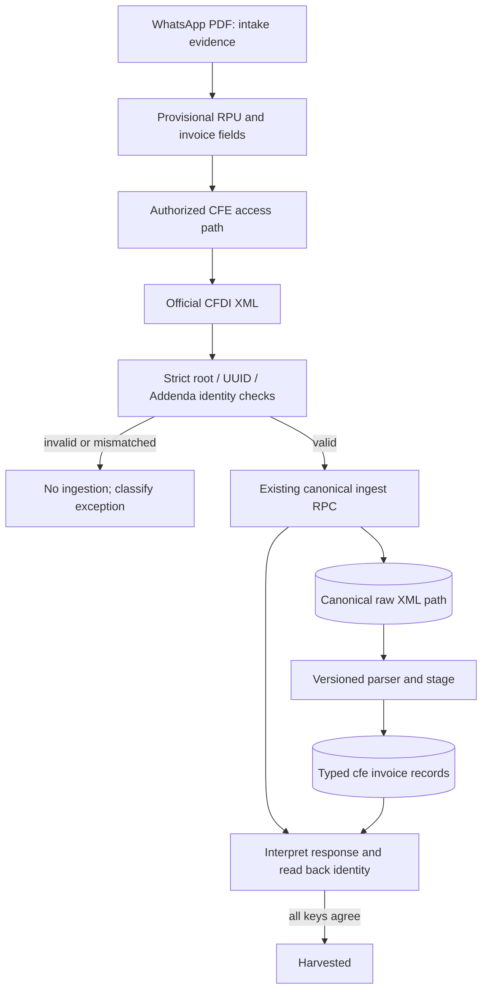

# CFDI and job data contract

## Trust boundaries

- WhatsApp PDF is untrusted intake evidence. Its decoded RPU is provisional and must match the RPU encoded in the Storage object path when that path contains one.
- CFDI XML is the source for harvested invoice identity. Missing/malformed fields fail closed; the parser never infers a current month.
- The existing canonical ingest RPC response and a read-back of the canonical record must agree before a job can enter `harvested`.

## Minimal harvest identity

| Field | Rule |
|---|---|
| Requested RPU | exactly 12 decimal digits |
| CFDI root | `{http://www.sat.gob.mx/cfd/4}Comprobante` |
| CFDI Version | exactly `4.0` for this initial contract |
| Timbre UUID | exactly one `TimbreFiscalDigital/@UUID`, valid UUID, normalized uppercase |
| XML RPU | exactly one unambiguous 12-digit Addenda attribute from the known names and equal to requested RPU |
| Billing period | exactly one associated `YYYYMM` or `YYYY-MM`, calendar month 01–12 |
| RPC outcome | explicit `inserted`, `duplicate_sha`, or `duplicate_period` result |
| Read-back | canonical UUID, RPU and period equal validated XML identity |

The accepted RPU/period attribute spellings are an initial test contract, not yet production-validated; check against an authorized, sanitized golden CFDI fixture before rollout. Do not widen parsing patterns simply to make a fixture pass.

This identity parser currently targets CFDI 4.0 and requires the CFE RPU and billing period in the same XML element’s attributes. A real authorized fixture must confirm that contract before treating it as production-valid.

## Offline state machine

Offline state machine order: validate source bucket/path/version → validate PDF and RPU → retrieve exact-account credential → harvest XML → independently parse/compare CFDI identity → ingest via injected canonical adapter → read back and compare. Missing credentials become a business exception; lookup outage is retryable; neither path registers an account. No live integrations are included in `hermes-cfe` at this point.

Do not assume table names, keys, RLS, or exact RPC statuses from the diagram; confirm them against live schema and RPC definitions first. No customer records or production credentials belong in this public repository.
