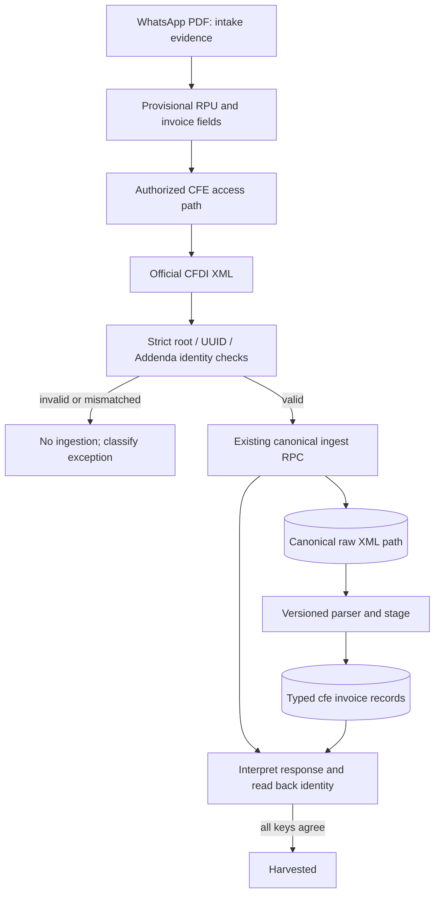

# CFDI data contract

## Trust boundaries

- WhatsApp PDF is untrusted intake evidence. Its decoded RPU and invoice-side fields are provisional.
- CFDI XML is the source for harvested invoice identity. A missing/malformed field is a failure, not a value to infer.
- Supabase intake RPC response must be interpreted, then canonical row read back before a job is marked harvested.

## Minimal harvest identity

The pure contract requires:

| Field | Rule |
|---|---|
| Requested RPU | exactly 12 decimal digits |
| CFDI root | `{http://www.sat.gob.mx/cfd/4}Comprobante` |
| CFDI Version | exactly `4.0` for this current parser contract |
| Timbre UUID | exactly one `TimbreFiscalDigital/@UUID`, valid UUID, normalized uppercase |
| XML RPU | exactly one unambiguous 12-digit Addenda field from known RPU attribute names, and equal to requested RPU |
| Billing period | exactly one associated `YYYYMM` or `YYYY-MM`, valid month 01–12 |
| RPC outcome | explicit `inserted`, `duplicate_sha`, or `duplicate_period` result |
| Read-back | canonical UUID, RPU and period equal the validated XML identity |

The allowed attribute spellings and period representation must be verified against a sanitized golden CFDI fixture before adapting production parsing. Do not widen patterns just to make a fixture pass.

## Canonical data flow

Do not assume table names, keys, RLS, or exact RPC statuses from this diagram; confirm them against live schema and RPC definitions first. No sample in this public repo contains live user/customer data.
